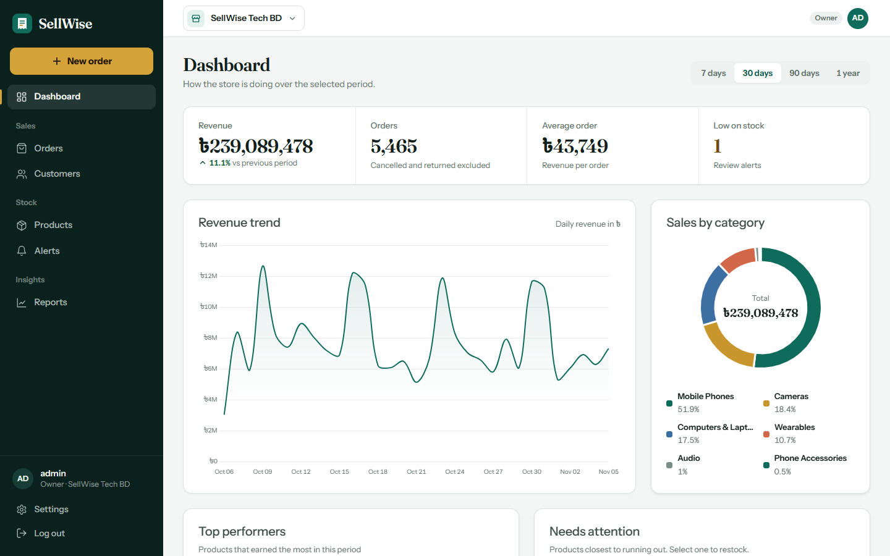
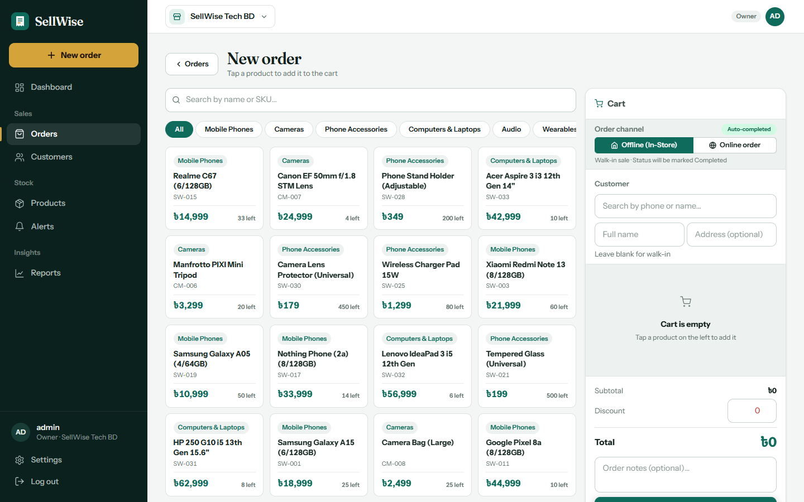
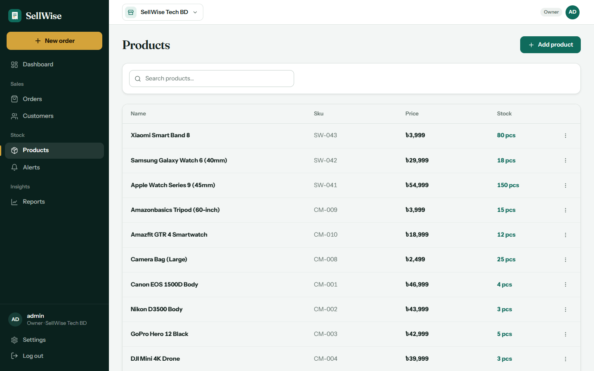

<div align="center">

# SellWise

**Point of sale, inventory and sales analytics for small retail shops.**

[](https://github.com/mr-sohel/SellWise/actions/workflows/ci.yml)


</div>



SellWise lets a shop ring up sales, keep stock accurate and see how the business is doing.
One account can run several stores, and each store's data is kept separate.

## Features

- **Point of sale.** Tap products to build an order, attach or create a customer, and choose walk-in or online.
  Every order has a printable invoice.
- **Inventory.** Manage products, restock with one click, and get low-stock alerts from current stock levels.
- **Dashboard.** Revenue (with the change since the last period), orders, average order value, a revenue trend,
  sales by category, top products, and the products closest to running out.
- **Customers.** Profiles with order count, total spent and last order date.
- **Reports.** A downloadable PDF sales report.
- **Multiple stores.** An owner can run several stores and switch between them.
- **Two roles.** Owners see everything. Staff can use the POS, orders and customers only.

## Screenshots

| Point of sale | Products |
|---|---|
|  |  |

## Quick start

You need the [.NET 10 SDK](https://dotnet.microsoft.com/download) and [Docker](https://www.docker.com/).

```bash
./scripts/start.ps1      # Windows
./scripts/start.sh       # macOS / Linux
```

This starts SQL Server in Docker and the app at **http://localhost:5000**. On the first run it creates the
database and fills it with two demo stores and 180 days of orders.

| Demo login | |
|---|---|
| Email | `admin@sellwise.com` |
| Password | `Admin123!` |

To wipe the database and reseed the demo data, run `./scripts/reset-db.ps1` or `./scripts/reset-db.sh`.

<details>
<summary>Run the parts by hand</summary>

```bash
docker run -d --name sellwise-sql -e ACCEPT_EULA=Y -e "MSSQL_SA_PASSWORD=YourPass123!" \
  -p 1433:1433 -v sellwise-data:/var/opt/mssql mcr.microsoft.com/mssql/server:2022-latest

cd SellWise.Web
dotnet run
```

</details>

## Built with

| | |
|---|---|
| **Backend** | ASP.NET Core 10 MVC, Entity Framework Core 10, ASP.NET Core Identity |
| **Database** | SQL Server |
| **Frontend** | Razor views, Bootstrap 5, Chart.js |
| **PDFs** | QuestPDF |
| **Tests** | xUnit, SQLite (unit), Testcontainers with SQL Server (integration) |
| **Delivery** | Docker Compose, Caddy (automatic HTTPS), GitHub Actions |

## How it works

```text
Browser ──HTTP──▶ SellWise.Web (ASP.NET Core MVC) ──EF Core──▶ SQL Server
```

Controllers stay thin. The business rules live in `Services/`. The decisions below are the ones I'd point to in
a code review.

### Every store's data stays separate

Every row belongs to a store (`StoreId`). Before each action, `BaseController` loads the user's membership for
the active store and exposes `StoreId` and `IsOwner`. Every query filters by `StoreId`, including lookups by id,
so nobody can open another store's order by guessing its id. Owner-only pages carry an `[OwnerOnly]` attribute,
and `BaseController` enforces it, so actions don't repeat role checks.

### Stock can't be oversold

Checkout lowers stock with a single conditional `UPDATE`:

```csharp
_db.Products
    .Where(p => p.Id == productId && p.StockQuantity >= quantity)
    .ExecuteUpdateAsync(s => s.SetProperty(p => p.StockQuantity, p => p.StockQuantity - quantity));
```

If it changes 0 rows, there wasn't enough stock. The database does the check and the decrement together, so two
cashiers selling the last item at the same moment can't both succeed. Reading the stock first and writing it back
can't give that guarantee. The order, the stock changes and the customer totals are saved in one transaction.

### Two people acting at once is safe

| Situation | Protection |
|---|---|
| Two people cancel the same order, and the stock comes back twice | Compare-and-swap: `UPDATE ... WHERE Status = @statusWeRead`. The second request matches 0 rows. |
| A double click or retry places the same order twice | An idempotency key in the POS form, with a unique index on `(StoreId, IdempotencyKey)` |
| Two orders for one customer at once lose an update to their totals | An atomic `SET TotalOrders = TotalOrders + 1` instead of load, add, save |
| Two owners edit the same product, and the last save silently wins | Optimistic concurrency with a `Version` token, and a conflict message for the stale edit |
| Two alert scans insert the same alert | A unique index. The duplicate insert is ignored. |

`Product.Version` is a plain counter rather than a SQL `rowversion` on purpose. Every sale updates the product
row, so with a `rowversion` an owner editing a price would get a false conflict whenever something sold.

Order statuses follow a small state machine (`Models/OrderStatus.cs`). For example, a completed sale can be
returned but not moved back to "pending".

### Other choices

- **Rate limiting.** ASP.NET Core's built-in limiter caps each user's traffic, limits login and signup attempts
  per IP, and applies a tighter limit to the dashboard. Rejected requests get `429` with a `Retry-After` header.
- **Soft delete for products.** Deleted products are hidden (`IsActive = false`), not removed, so past orders and
  reports stay correct.

## Tests

```bash
dotnet test SellWise.slnx      # needs Docker for the integration tests
```

- **Unit tests** check the checkout and cancellation rules against in-memory SQLite.
- **Integration tests** run the real app against a throwaway SQL Server container and act like a browser
  (cookies, forms, anti-forgery tokens). They check that:
  - the owner of one store can't read or change another store's orders, products or customers by guessing ids
  - staff are kept out of owner pages
  - requests without an anti-forgery token are rejected
  - parallel requests can't oversell, double-cancel, double-submit or lose customer updates
  - rate limits return `429` once exceeded

The concurrency tests send 12 requests at the same moment for each race above. I checked each one by putting the
bug back. Without the atomic increment, for example, 12 simultaneous orders for one customer were counted as 1.

GitHub Actions runs the tests on every push and pull request.

## Deployment

`docker-compose.yml` runs SQL Server and the app on a private network behind Caddy, which handles HTTPS. Only
Caddy is exposed to the internet.

```bash
cp .env.example .env    # set SA_PASSWORD and DOMAIN (and optionally a demo account)
docker compose up -d --build
```

## Project structure

```text
SellWise.Web/
  Authorization/   roles and the [OwnerOnly] attribute
  Controllers/     thin MVC controllers; BaseController resolves the store and role
  Data/            AppDbContext, startup migration and demo data
  Infrastructure/  rate limiting
  Migrations/      EF Core migrations
  Models/          entities
  Services/        business logic (orders, products, customers, analytics, alerts)
  ViewModels/      form and view models (entities are never bound directly)
  Views/           Razor views
SellWise.Tests/    Unit/ (fast, SQLite) and Integration/ (real app + SQL Server container)
scripts/           start and reset-db scripts for PowerShell and bash
docs/              screenshots, plus the original project report (describes an earlier, larger version)
```

## Known limitations

- Dates are stored and grouped in UTC, so "today" follows UTC rather than the store's time zone.
- The owner creates staff accounts with a password. There are no email invitations.
- Low-stock alerts use a fixed threshold per product. There is no demand forecasting.

## License

[MIT](LICENSE)
